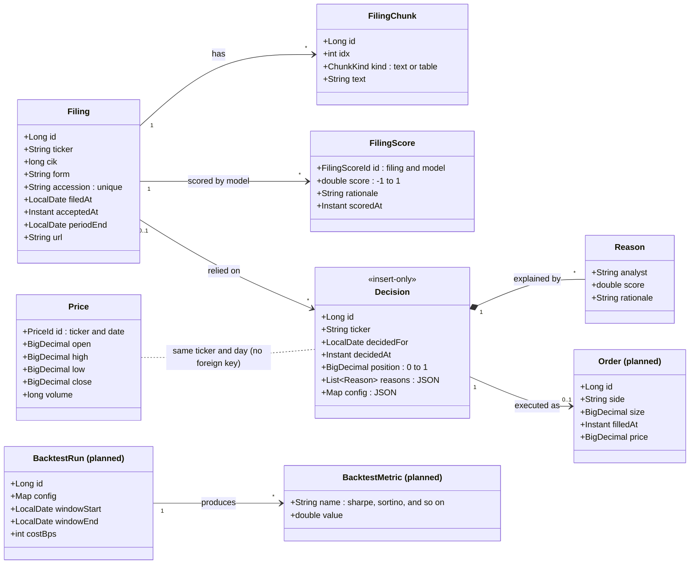
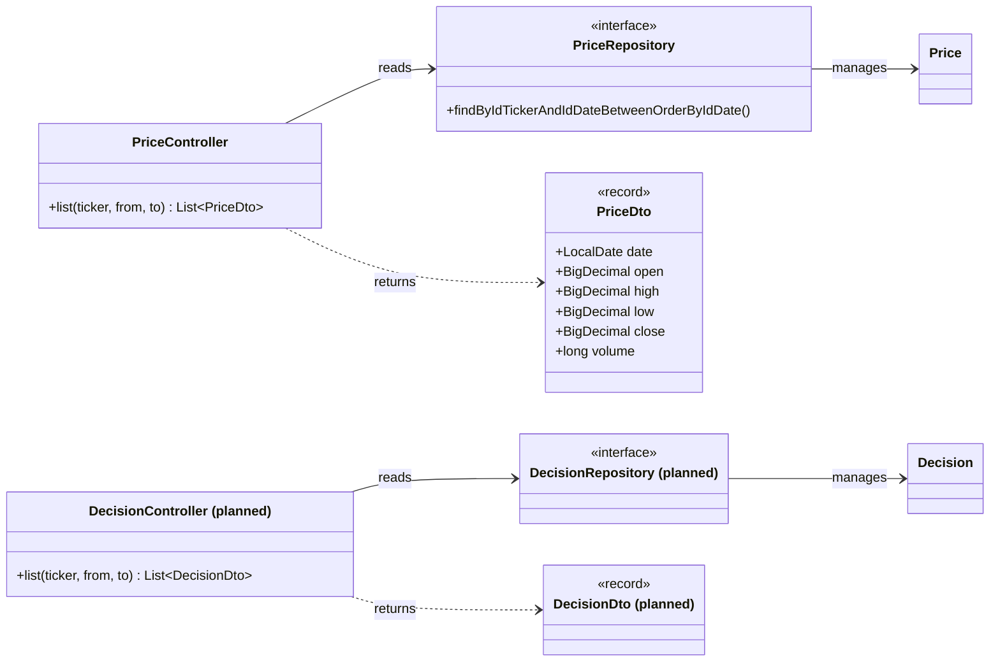
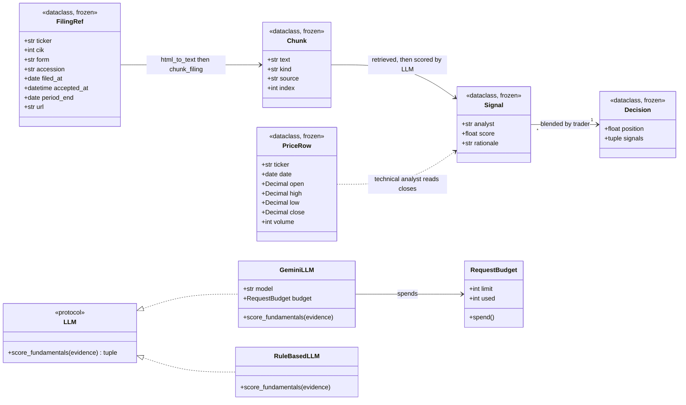

# TapeLab: Class Diagrams

Three views of the same system: the database tables as Java entities, the Java backend classes built on them, and the Python objects that produce the data. Boxes marked `planned` do not exist yet.

## 1. Database entities (tables and how they relate)

## 2. Java backend (first endpoints, built on the entities)

## 3. Python engine (objects that produce the data)

Note: the Python `Decision` is the trader's in-memory result (a position plus the signals behind it). It becomes a row of the database `Decision` entity when it is saved.
