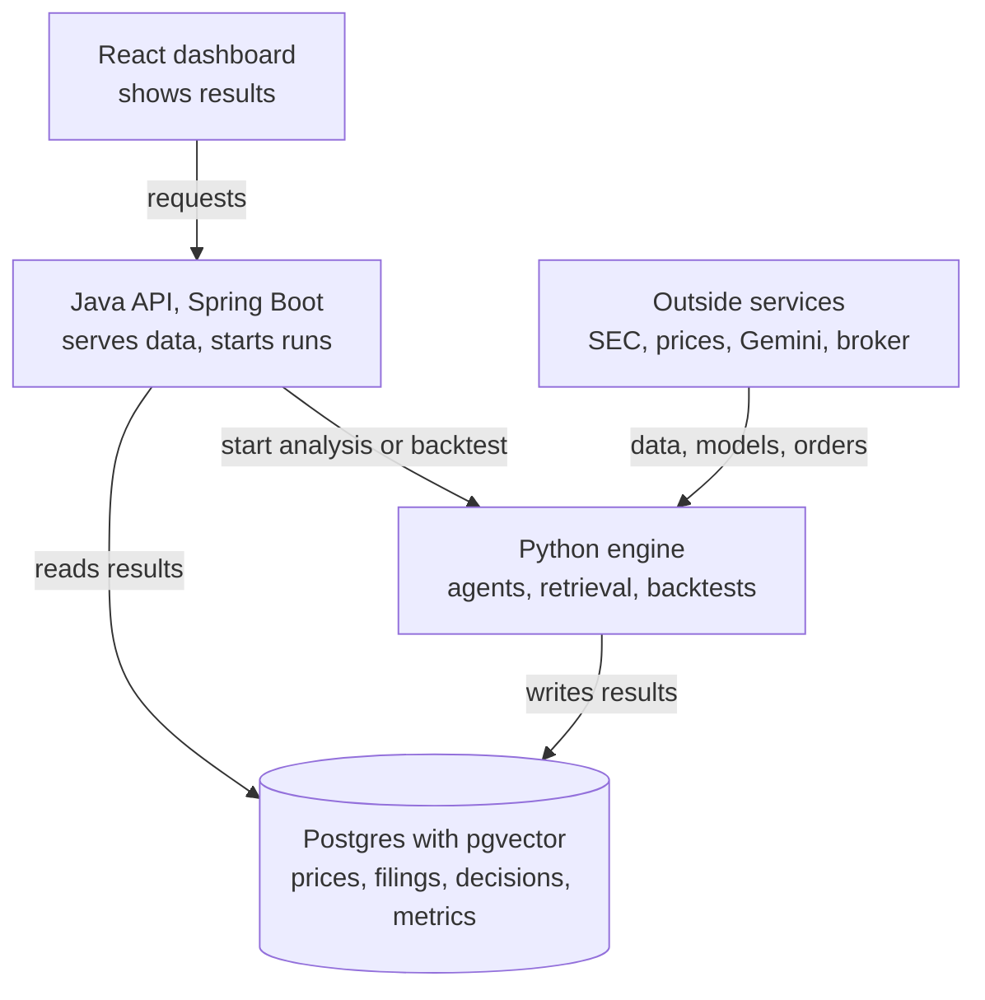

# TapeLab: Technical Design

2026-10-23

## Architecture

TapeLab has three parts around one Postgres database: a Python engine does the AI and evaluation work, a Java API serves clients, and a React dashboard shows the results. Python writes decisions and metrics; Java reads and serves them.



The dashboard only talks to Java, and Java never runs the AI work itself. Python and Java share data through Postgres.

| Component | Technology | Responsibility | Status |
| --- | --- | --- | --- |
| Agent engine | Python 3.11+, Gemini | Analysts, trader, retrieval, decisions | Skeleton built |
| Evaluation engine | Python (`tradeval`) | Backtests, metrics, leakage checks | Built; real data pending |
| Engine service | FastAPI | Lets Java start analyses and backtests | Health and verify endpoints only |
| Backend API | Java 21, Spring Boot 3.4 | Watchlist, decisions, portfolio, backtests for the dashboard | Early skeleton, to be reworked |
| Database | Postgres, pgvector | Prices, filings, chunks, decisions, metrics | Planned |
| Dashboard | React, TypeScript, Vite | Insights, portfolio, comparisons | Planned |
| Broker | Paper-trading account (Alpaca likely) | Executes daily orders with no real money | Planned |

## Data layer

Everything lives in Postgres, and every row that came from outside carries the date it became public, so the agent can be kept from seeing the future. The schema below is a proposal; none of it is created yet.

| Table | Holds | Key columns |
| --- | --- | --- |
| `prices` | Daily bars per ticker | ticker, date, open, high, low, close, volume |
| `filings` | One row per SEC filing | ticker, form, accession, filed_at, url |
| `filing_chunks` | Chunked text with embeddings | filing_id, idx, kind (text or table), text, embedding (pgvector) |
| `insights` | One analyst's view of one ticker on one date | ticker, as_of, analyst, score, rationale, evidence |
| `decisions` | The final call, written before the outcome | ticker, decided_at, position, reasons, config_id |
| `orders` and `positions` | Paper-trading activity | decision_id, side, size, filled_at, price |
| `backtest_runs` and `backtest_metrics` | Each test and its results | config, window, cost_bps, return, sharpe, sortino, max_drawdown |

**Point-in-time rules**

- A filing is visible only from its `filed_at` date, never its period-end date.
- A decision made on day t may read rows dated t or earlier, and executes at the next trading day's price.
- Decisions are insert-only. Outcomes are written to separate rows, so a decision is never edited after the fact.
- Prices come from a free source such as yfinance or the broker's data API, and are stored so every run uses the same history.
- SEC requests send a descriptive User-Agent and stay under 10 requests per second, as the SEC requires.

## Agent pipeline

Each analyst turns data into a `Signal` (analyst name, a score from -1 to 1, and a rationale), and the trader blends the signals into a `Decision` (a target position from 0 to 1 plus the signals behind it).

| Piece | File | Behavior |
| --- | --- | --- |
| Technical analyst | `agents/technical.py` | Fast and slow moving-average crossover (10 and 30 days by default), scaled to a score; returns 0 with too little history |
| Fundamentals analyst | `agents/fundamentals.py` | Chunks a filing, retrieves the top 3 passages, and asks the LLM to score them |
| Trader | `agents/trader.py` | Weighted average of scores; long (1.0) if positive, otherwise flat (0.0) |
| LLM interface | `agents/llm.py` | A `score_fundamentals(evidence)` protocol; `RuleBasedLLM` counts positive and negative words for offline use |
| Gemini client | `agents/gemini.py` | `GeminiLLM` calls the Gemini `generateContent` REST API |

**Gemini client**

- Reads `GEMINI_API_KEY` and `GEMINI_MODEL` from the environment or a git-ignored `.env`; `gemini-2.5-flash-lite` worked in a live check.
- Sends temperature 0 and asks for JSON with a score and a one-sentence reason; the score is clamped to [-1, 1].
- `RequestBudget` raises an error once a daily cap is reached (default 1,400 requests). The true quota must be confirmed in AI Studio, and the cap lowered if it is smaller.
- Planned: cache each filing's score so the model is called once per filing, plus a pause between calls to respect the per-minute limit.

**Planned**

- Move the sequential functions onto LangGraph with parallel analysts.
- Add a news and sentiment analyst, a bull and bear debate, and a risk check that can veto a trade.

## Retrieval

Filing tables are dense with numbers, and splitting them mid-table breaks the link between a figure and its row and column. So the chunker keeps every table whole and packs prose by paragraph.

| Step | Implementation | Status |
| --- | --- | --- |
| Chunking | `chunk_filing`: table blocks never split; prose packed up to 1,200 characters | Built, tested |
| Keyword search | `bm25_rank` with k1 = 1.5 and b = 0.75 over lowercase tokens that keep `$`, `%` and `.` | Built, tested |
| Rank fusion | `rrf` merges ranked lists with reciprocal rank fusion (k = 60) | Built, tested |
| Dense search | Embeddings in pgvector, fused with BM25 through `rrf` | Planned |
| Reranker | Rerank the fused top results before the LLM reads them | Planned |
| Answer check | `ungrounded_numbers` lists numbers in an answer that appear in none of the cited passages | Built, tested |

The answer check is a validation step for the API: `/verify` takes an answer and its evidence and reports unsupported numbers. Retrieval settings (chunk size, hybrid against dense, reranker on or off) are what the FinanceBench and T2-RAGBench ablations will vary.

## Evaluation engine

The `tradeval` package decides whether the agent is any good, and it is built so that cheating by accident is hard.

| Function | File | What it guarantees |
| --- | --- | --- |
| `backtest(closes, position_fn, cost_bps)` | `backtest.py` | The position chosen at day t's close earns day t+1's return; a cost of 5 basis points (default) is charged on each position change; a test checks the function only sees data up to day t |
| `buy_and_hold(closes)` | `backtest.py` | The baseline daily returns |
| `sharpe`, `sortino` | `metrics.py` | Annualized return per unit of total and of downside risk |
| `max_drawdown`, `cumulative_return`, `alpha` | `metrics.py` | Worst peak-to-trough loss, total return, and excess return over a benchmark |
| `ablation_grid(**axes)` | `metrics.py` | Every combination of the settings being compared |
| `leaked(docs, decision_date)` | `leakage.py` | Lists any document the agent saw that was published after the decision date |
| `entry_date(decision, trading_days)` | `leakage.py` | The first trading day strictly after a decision |

**Still to add**

- The deflated Sharpe ratio, to account for the number of configurations tried.
- Walk-forward splits and confidence intervals on the metrics.
- A runner that stores each configuration's results in `backtest_runs` and `backtest_metrics`.

The demo (`python -m tapelab.demo`) uses a seeded random walk and a made-up filing. Its output only shows the code runs and says nothing about performance.

## Backend API

The Java service (Spring Boot 3.4, Java 21, Spring Data JPA) is the only thing the dashboard talks to. It reads what Python writes to Postgres, and asks the Python engine to do new work.

| Endpoint | Purpose | Status |
| --- | --- | --- |
| `GET` and `POST /watchlist` | Tickers being followed | Planned |
| `POST /analyze/{ticker}` | Ask the engine for a fresh insight and decision | Planned |
| `GET /decisions?ticker=` | Decision history with reasons and evidence | Planned |
| `GET /portfolio` | Paper positions, profit and loss | Planned |
| `POST /backtests`, `GET /backtests/{id}` | Run and read a backtest | Planned |

**Integration**

- Reads: Java queries the shared Postgres tables directly.
- Writes that need AI or evaluation: Java calls the Python FastAPI service, which runs the work and records status in Postgres.
- Input is validated with Bean Validation, and errors return clear 400 responses.

**What exists today**

The Java service is currently an empty Spring Boot shell (`BackendApplication`) with one smoke test that checks the app starts. The earlier experiment endpoints were removed because the product does not need them. Known gap: the test runs on an H2 database, not real Postgres (Testcontainers is the fix).

## Paper trading, testing and setup

**Paper trading (planned).** A scheduler runs once per trading day, after the close. For each watchlist ticker it loads data dated on or before that day, produces a decision, writes it to `decisions`, and sends an order to the broker's paper account for the next session. Fills and profit are recorded in `orders` and `positions`. The Java service or a Python job can host the scheduler; Python is simpler because the agent is already there.

**Testing and CI**

- 19 Python tests (pytest) cover chunking, retrieval, grounding, metrics, leakage, the pipeline, the backtester and the Gemini client against a mock HTTP server.
- 3 Java tests (JUnit and MockMvc) cover the grid expander and the API on H2.
- GitHub Actions runs `ruff` and `pytest` on every push. Adding the Java tests to CI is open work.
- No test calls a live API. Live Gemini access is checked by hand with `python -m tapelab.check_gemini`.

**Repo layout**

```text
tapelab/
  src/tapelab/        chunking, retrieval, grounding, edgar, api, demo
    agents/           technical, fundamentals, trader, llm, gemini
  src/tradeval/       backtest, metrics, leakage
  backend/            Java Spring Boot backend
  tests/              Python tests
  docs/               product and technical documents
  .github/workflows/  CI
  .env.example        template for local secrets
```

**Local setup**

```text
python3 -m venv .venv && source .venv/bin/activate
pip install -e ".[dev]"
cp .env.example .env        # add GEMINI_API_KEY; .env is git-ignored
python -m tapelab.check_gemini
pytest
```

Secrets stay in `.env` locally or in the cloud environment's secret settings. They are never committed or pasted into chat.
